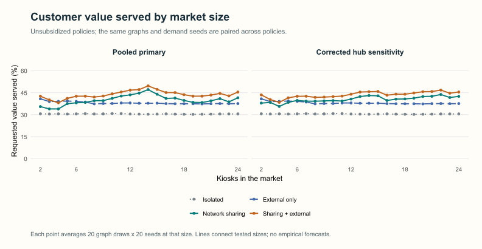
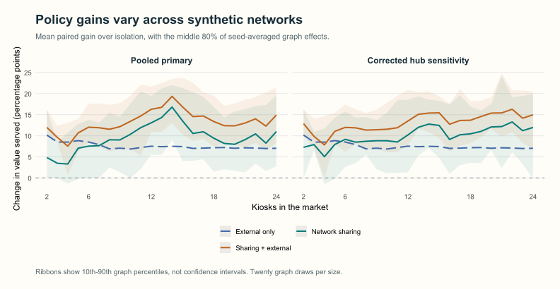
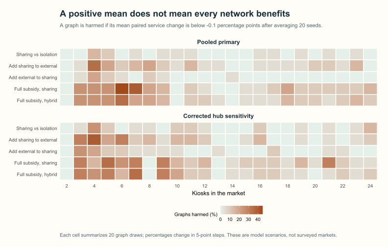
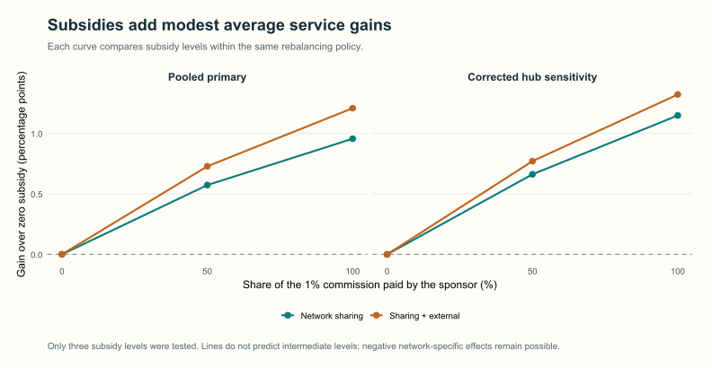
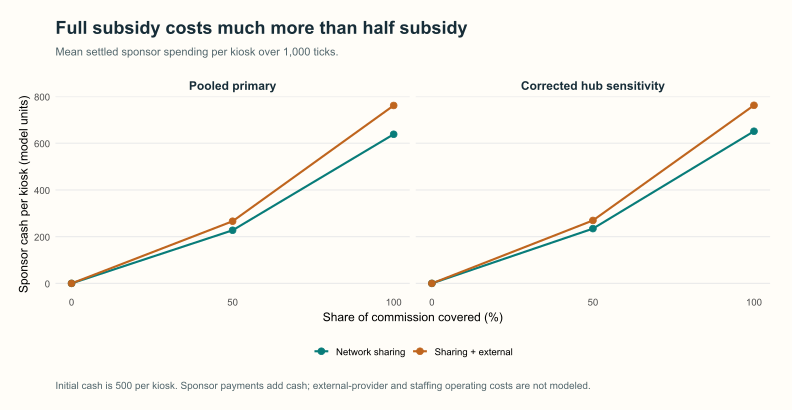
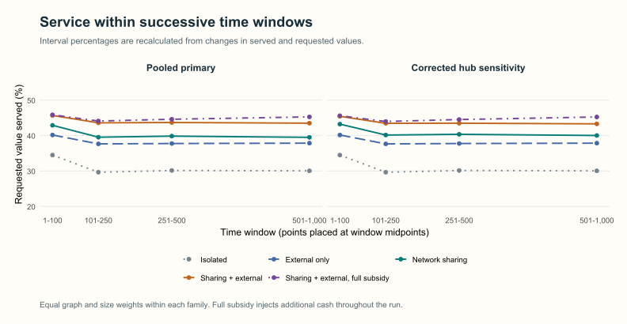
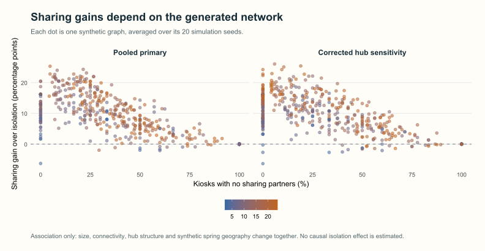

<link rel="stylesheet" href="../style.css">
<link rel="stylesheet" href="report.css">

[Project](../../) · [Results dashboard](../) · [Small pilot](../policy-pilot/) · [Download figures](figures/policy-study-figures.pdf)

# Liquidity sharing helps on average. The network and routing rule matter.

The full study compares **147,200 simulations** across **920 synthetic networks**,
eight policies and 20 seeds. Sharing with external fallback serves the most
customer value on average under both network generators. Fee subsidies add smaller
gains at a substantial cash cost. Neither sharing nor subsidies benefit every network.

<strong>+5.75 pp</strong>Adding peer-first sharing to external access: mean gain, pooled networks

<strong>8.9%</strong>Of pooled graph means lose service under that same comparison

<strong>+1.21 pp</strong>Full subsidy adds to unsubsidized sharing + external fallback

Headlines concern requested **money value served**, not transaction counts.
“pp” means percentage points. These are conditional results under illustrative
financial and travel assumptions, not forecasts for surveyed markets. The
corrected hub networks provide a structural sensitivity check.

## What do the policies achieve?

Under the primary pooled generator, mean value served rises from **30.45%** under
isolation to **38.02%** with external-only rebalancing, **39.92%** with sharing
alone, and **43.76%** with sharing plus external fallback. Full subsidy raises the
hybrid to **44.97%**. The corrected hub alternative has the same broad ranking:
**40.43%**, **43.57%** and **44.89%** for sharing, the unsubsidized hybrid and the
fully subsidized hybrid, respectively.

<label for="family">Network generator for tables
<select id="family"><option value="pooled">Pooled primary</option><option value="corrected_hub">Corrected hub sensitivity</option></select>
</label>

Pooled primary · 460 graphs · 20 seeds per graph · 1,000 ticks.

<table id="policy-table">
<thead><tr><th>Policy</th><th>Value served</th><th>Gain vs isolated</th><th>Graphs harmed vs isolated</th><th>Closed kiosk-time</th><th>Subsidy / kiosk</th></tr></thead>
<tbody>
<tr><td>Isolated</td><td>30.45%</td><td>0.00 pp</td><td>0.0%</td><td>0.0%</td><td>0</td></tr>
<tr><td>External only</td><td>38.02%</td><td>+7.57 pp</td><td>0.0%</td><td>16.4%</td><td>0</td></tr>
<tr><td>Network · no subsidy</td><td>39.92%</td><td>+9.47 pp</td><td>3.0%</td><td>15.8%</td><td>0</td></tr>
<tr><td>Network · 50% subsidy</td><td>40.49%</td><td>+10.04 pp</td><td>3.3%</td><td>15.9%</td><td>227</td></tr>
<tr><td>Network · 100% subsidy</td><td>40.87%</td><td>+10.43 pp</td><td>3.3%</td><td>16.0%</td><td>638</td></tr>
<tr><td>Network + external · no subsidy</td><td>43.76%</td><td>+13.32 pp</td><td>0.2%</td><td>24.7%</td><td>0</td></tr>
<tr><td>Network + external · 50% subsidy</td><td>44.49%</td><td>+14.04 pp</td><td>0.2%</td><td>24.8%</td><td>266</td></tr>
<tr><td>Network + external · 100% subsidy</td><td>44.97%</td><td>+14.53 pp</td><td>0.2%</td><td>24.8%</td><td>762</td></tr>
</tbody></table>

A graph is **harmed** here when its service change, averaged over 20 matched seeds,
is below **−0.1 pp**; smaller changes are treated as negligible. Sponsor spending
is settled cash per kiosk over 1,000 ticks in model units. Each kiosk initially
holds 500 cash and 500 e-float. Results average seeds within a graph, then give
each graph equal weight; this also gives each tested size equal weight.

<label for="size-response">Response shown in the size chart
<select id="size-response"><option value="service_pct">All customer value</option><option value="deposit_service_pct">Deposit value</option><option value="withdrawal_service_pct">Withdrawal value</option></select>
</label>

<figure><figcaption>Each size has 20 graph draws and 20 seeds. Topology and synthetic spring geography vary together; these curves do not isolate a causal effect of size or density.</figcaption></figure>

## Choose the comparator that matches the policy question

Isolation disables both peer and outside rebalancing. If outside rebalancing
represents existing practice, the relevant comparison is **adding sharing to
external access**. That change gains **5.75 pp** under pooled networks and
**5.55 pp** under corrected hub networks, but harms **8.9%** and **10.2%** of graph
means. Losses exceed one point in **6.5%** and **7.8%**, respectively.

<table id="contrast-table">
<thead><tr><th>Paired policy change</th><th>Mean change</th><th>Middle 80% of graph effects</th><th>Graphs harmed</th><th>Loss &gt;1 pp</th></tr></thead><tbody>
<tr><td>Add sharing to external access</td><td>+5.75 pp</td><td>0.00 to +13.93 pp</td><td>8.9%</td><td>6.5%</td></tr>
<tr><td>Full subsidy vs unsubsidized sharing</td><td>+0.96 pp</td><td>−0.24 to +2.87 pp</td><td>13.7%</td><td>1.7%</td></tr>
<tr><td>Full subsidy vs unsubsidized hybrid</td><td>+1.21 pp</td><td>−0.20 to +3.27 pp</td><td>12.2%</td><td>2.6%</td></tr>
</tbody></table>

The hybrid uses a **peer-first rule**: it accepts a feasible peer trade before
considering outside service, and a partial peer refill blocks an outside order
in that tick. It does not compare both options' delays and fees. These results
evaluate that rule, rather than an operator choosing optimally among more options.

The joint gain is smaller than the sum of the standalone gains—by **3.72 pp** in
pooled networks and **4.43 pp** in corrected hub networks. The mechanisms overlap;
adding their separate gains would overstate the hybrid's benefit.

<figure><figcaption>Ribbons show network-to-network spread after seed averaging, not confidence intervals. Negative effects can occur outside the middle 80% band.</figcaption></figure>
<figure><figcaption>Each cell has 20 graph draws: five percentage points correspond to one graph. Small-sample jumps are not exact population risk estimates.</figcaption></figure>

## Subsidies: modest service gains at a cash cost

Full subsidy adds **0.96 pp** to sharing-only service under pooled networks and
**1.15 pp** under corrected hub networks. For the hybrid, it adds **1.21 pp** and
**1.32 pp**. These are much smaller than the gains from introducing rebalancing.

<figure></figure>

For pooled networks, half subsidy costs the hybrid's sponsor **266 cash units per
kiosk** and adds **0.73 pp** of service. Moving from half to full costs another
**496 units per kiosk** for another **0.48 pp**. Full subsidy totals **762 units
per kiosk**, exceeding the initial 500-unit cash balance. The corrected hub
alternative shows the same diminishing average trade-off.

<figure></figure>

The sponsor covers a share of a **1% commission**, not of the entire swap.
Payments add market cash: the effect combines fee relief and extra working capital,
which this design cannot separate. Full subsidy still harms **13.7%** of sharing-only
graph means and about **12%** of hybrid graph means relative to their unsubsidized
versions. Trade feasibility and evolving balances need not improve monotonically.

Downloads include additional served value per sponsor cash unit, calculated as a
ratio of aggregate paired value changes to aggregate spending. This is additional
**transaction turnover**, not profit, GDP or a welfare return. Outside-provider,
travel and staffing costs are not monetized; sponsor spending alone cannot rank
policies by real-world cost-effectiveness.

## Do the gains persist?

In pooled networks, unsubsidized hybrid service is **43.49% in ticks 501–1,000**,
against **30.04%** for isolation and **37.84%** for external-only rebalancing. Its
benefit persists beyond the initial balance period. The fully subsidized hybrid
reaches **45.26%** in that window while continuing to receive cash; this does not
establish a stationary, self-financing equilibrium.

<label for="time-view">Time view
<select id="time-view"><option value="interval">Separate time windows</option><option value="cumulative">Cumulative through checkpoints</option></select>
</label>

<figure><figcaption>Interval rates are recomputed from changes in cumulative served and requested values. They are not differences between cumulative percentages. No economic burn-in is discarded.</figcaption></figure>

## Closures and network structure

The pooled hybrid closes kiosks for **24.7% of kiosk-time**, compared with **15.8%**
for sharing alone. The recorded failure mix shifts toward closures and away from
shortages. Busy kiosks receive more traffic, so the fraction of requests lost
during closure can exceed the fraction of kiosk-time closed.

<table id="failure-table">
<thead><tr><th>Unsubsidized policy</th><th>Requests served</th><th>Failed: closed</th><th>Failed: cash</th><th>Failed: e-float</th></tr></thead><tbody>
<tr><td>Isolated</td><td>40.20%</td><td>0.00%</td><td>28.38%</td><td>31.42%</td></tr>
<tr><td>External only</td><td>46.10%</td><td>21.34%</td><td>13.91%</td><td>18.65%</td></tr>
<tr><td>Network sharing</td><td>48.31%</td><td>17.87%</td><td>15.94%</td><td>17.88%</td></tr>
<tr><td>Sharing + external</td><td>51.04%</td><td>29.06%</td><td>8.67%</td><td>11.23%</td></tr>
</tbody></table>

These are shares of **request counts**, unlike the value-based headlines.
Closure is checked before balances, so this is not a causal decomposition: some
requests lost during closure might also have failed for insufficient liquidity.
A staffed-shop or travel intervention is needed to isolate avoidable closure losses.

<figure><figcaption>Each dot is one generated graph averaged over its seeds. The association does not isolate connectivity from size, other structure or the spring layout.</figcaption></figure>

## What should be tested next?

- **Route by expected interruption:** compare peer-first with a rule that considers
  outside service when a peer is slower or offers only a small refill.
- **Reduce closure costs:** cross travel, staffing and refill triggers before
  assuming more frequent rebalancing is beneficial.
- **Target subsidy experiments:** test half/full coverage, spending caps and a
  matched cash-injection control before recommending universal coverage. Caps and
  cash-only grants need additional model mechanisms.
- **Vary access and demand:** test outside access, hours, peer participation and
  demand pressure, which this core study holds fixed.

## Assumptions and statistical interpretation

Show the actual settings held fixed

<table>
<thead><tr><th>Setting</th><th>Value</th></tr></thead><tbody>
<tr><td>Graphs</td><td>20 draws per size 2–24, per generator; four equally weighted bootstrap fits</td></tr>
<tr><td>Replication and horizon</td><td>20 matched seeds, 11–220 in steps of 11; 1,000 ticks</td></tr>
<tr><td>Observations</td><td>Ticks 100, 250, 500 and 1,000</td></tr>
<tr><td>Initial holdings</td><td>500 cash + 500 e-float per kiosk</td></tr>
<tr><td>Trigger / target / outgoing reserve</td><td>25% / 50% / 100 units</td></tr>
<tr><td>Peer participation</td><td>100% when enabled; fixed network ties</td></tr>
<tr><td>Fee / subsidy</td><td>Uniform 1%; subsidy 0%, 50% or 100%; no sponsor budget cap</td></tr>
<tr><td>Travel</td><td>Fixed spring layout, grid size 5, Manhattan distance; requester closes</td></tr>
<tr><td>External access</td><td>Independent 50% assignment, fixed within a run</td></tr>
<tr><td>External service</td><td>3 travel + 1 service ticks; open 8/12 ticks; cap 500; no shared capacity limit or fee</td></tr>
<tr><td>Demand</td><td>2 × kiosk count requests per tick; base amount uniform 1–100</td></tr>
<tr><td>Demand differences</td><td>Traffic log-SD 1; size log-SD 0.5; withdrawal share 0.5; polarization 0.35</td></tr>
</tbody></table>

Effects pair policies on the same graph and seed, average seeds within each graph,
then weight graphs equally. Deposit, withdrawal and total service use their own
denominators; separately averaged ratios need not combine into the overall mean.
Bands are the middle 80% of graph effects, not confidence intervals.

Graphs sharing a bootstrap fit, repeated shapes and reused simulation seeds are
not independent empirical markets. Four fitted bootstrap groups and a finite
library do not justify precise population confidence claims. Group summaries are
downloadable. Agreement between generators supports structural robustness within
this model family, not external validity.

Ties represent **mutual stated willingness to trade**, not observed transfers.
Isolates and disconnected graphs remain. Kiosk behavior, demand, travel and fees
are illustrative. Spring positions are synthetic geography. Ticks have no calibrated
mapping to hours or days; customer service is a proxy for money flow, not a full economy.

## Validation, downloads and reproducibility

All **147,200 final runs** and **588,800 snapshots** passed checks of planned
controls, provenance, seed pairing, request identity, service denominators, failure
counts, cash/e-float ledgers, commissions and pending exchanges. There were
**zero error attempts and no duplicate attempts or snapshots**. Final snapshots
match final results. Observation was separately checked to preserve model outcomes.

The study finished November 25, 2026 at **1:53 a.m. Eastern**, taking **13 hours
17 minutes**. Neither model file changed for this analysis; v1 is unchanged. The
[prelaunch estimate](runtime-estimates.json) is a historical timing record.

- [Table data and validation metadata](analysis.json)
- [Cumulative and interval policy outcomes](outcomes.csv) and [outcomes by size](size-outcomes.csv)
- [Direct paired comparisons](contrasts.csv) and [comparisons by size](size-contrasts.csv)
- [Seed-averaged graph outcomes](graph-outcomes.csv) and [synthetic structure](network-structure.csv)
- [Fitted bootstrap-group summaries](bootstrap-groups.csv)
- [All figures as a PDF](figures/policy-study-figures.pdf)
- [Analysis and run instructions](https://github.com/gabemgem/mobile-bank-markets/blob/main/experiments/POLICY_STUDY.md)

Only aggregates from the already public synthetic library are included. Raw runs,
trajectories, logs, surveys and private fitted objects stay local.

Tables show the pooled primary results. Select a generator to compare the sensitivity alternative.

